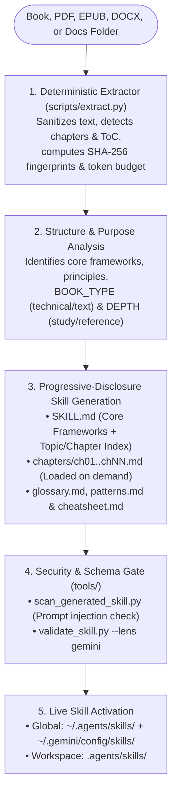

# Gemini Book to Skill

Turn any technical book, PDF, EPUB, DOCX, or documentation folder into a structured, on-demand Google Antigravity and Gemini skill — with **24x to 51x fewer tokens** than dumping the book into context.

---

## Overview

When working with technical books, architecture specifications, or large documentation folders, the usual approaches break down:
- **Searching the PDF** gives you raw page hits instead of synthesized answers.
- **Asking an LLM without the text** risks hallucinated frameworks or generic summaries.
- **Dumping the whole book into context (or navigating it on every turn)** pays a massive "Discovery Loop Tax" — re-reading the Table of Contents, pulling raw chapters, and burning tens of thousands of tokens on every question.

**Gemini Book to Skill** solves this by packaging a **deterministic Python multi-format extractor** (`book_to_skill`), a **spec-driven skill generator** (`skills/book-to-skill`), and **three verification & benchmarking tools** (`tools/`) into a single Google Antigravity and Gemini plugin:

1. **Multi-Format Deterministic Extractor (`scripts/extract.py`)**: Extracts clean, sanitized text, SHA-256 content fingerprints, Table of Contents flags, token estimates, and multilingual chapter structure from PDF, EPUB, DOCX, HTML, RTF, MOBI/AZW (via Calibre), Markdown, AsciiDoc, reStructuredText, and plain text.
2. **Progressive-Disclosure Skill Generator (`skills/book-to-skill`)**: Distills any source into a compact core `SKILL.md` (<= 4,000 tokens) plus on-demand `chapters/ch<NN>-<slug>.md` files, `glossary.md`, `patterns.md`, and a decision-oriented `cheatsheet.md`.
3. **Incremental Update & Fold-In Mode**: Merge new papers, additional chapters, or updated runbooks into an existing book skill without starting from scratch.
4. **Security & Schema Verification (`tools/`)**: Scans generated skills for prompt injection, invisible Unicode characters, and authority escalation (`scan_generated_skill.py`), validates `SKILL.md` frontmatter against Google Antigravity / Gemini and cross-agent rules (`validate_skill.py`), and quantifies token savings (`discovery_tax.py`).



---

## Quick Start & Installation

You can install **Gemini Book to Skill** globally across all your workspaces or locally inside a single project with one command.

### Option 1: One-Command Global Installation *(Recommended)*

Clone the repository and run the installer in a single command to activate `book-to-skill` across every Google Antigravity and Gemini workspace:

```bash
git clone https://github.com/Norbert-Brett/gemini-book-to-skill.git ~/.gemini-book-to-skill && bash ~/.gemini-book-to-skill/scripts/install.sh
```

Or if you have already cloned this repository locally:

```bash
bash scripts/install.sh
```

Verify or uninstall at any time:

```bash
# Verify plugin manifest, rules, extractor, and skill
bash scripts/install.sh --check

# Uninstall global plugin symlink
bash scripts/install.sh --uninstall
```

### Option 2: Project-Local Installation *(For Teams)*

Install the plugin directly inside your project's `.agents/plugins/` directory so it can be shared via version control:

```bash
bash scripts/install.sh --workspace
```

Antigravity automatically discovers plugins in `.agents/plugins/` when opening the project.

> **Requirements**: Python 3.8 or newer. Plain text, Markdown, HTML, DOCX, EPUB, and RTF work out of the box using Python standard library fallbacks. Run `python3 scripts/extract.py --check` to inspect optional high-precision extractors (`pypdf`, `pdfminer.six`, `pdftotext`, `docling`, `ebooklib`, `python-docx`, `trafilatura`, `striprtf`, `ebook-convert`).

---

## How to Use: Step-by-Step

Once installed, the `book-to-skill` skill and its operating rules are automatically discovered by Google Antigravity IDE, Antigravity 2.0, and the `agy` / `gemini` CLI.

### 1. Four Modes of Operation

Ask the agent to convert, analyze, or update any document or folder:

- **Mode 1: Full Conversion (Default)**
  `"Use book-to-skill to convert ./designing-data-intensive-apps.pdf into a skill"`
- **Mode 2: Analyze Only (Preview Before Generating)**
  `"Use book-to-skill to analyze ./architecture-docs/ and show me the extraction report first"`
- **Mode 3: Generate from Prior Analysis**
  `"Generate the full book skill from the extraction analysis above"`
- **Mode 4: Update / Fold-In (Merge New Material into an Existing Skill)**
  `"Use book-to-skill to fold ./new-rfcs/ into my existing kleppmann-data-intensive skill"`

### 2. What It Generates

Every converted book or document collection produces a self-contained skill directory:

| File | Purpose | Target Budget |
| :--- | :--- | :--- |
| `SKILL.md` | Core mental models, named frameworks, Chapter Index, and alphabetical Topic Index | <= 4,000 tokens |
| `chapters/ch01-*.md` ... | One structured file per chapter (Core Idea, Frameworks, Concepts, Code/Tables, Worked Example, Takeaways) — **loaded on demand** | 800 - 3,000 tokens each |
| `glossary.md` | Alphabetically sorted key terms with chapter references | <= 1,500 tokens |
| `patterns.md` | Concrete techniques, algorithms, and design patterns with trade-offs | <= 2,000 tokens |
| `cheatsheet.md` | High-density decision rules ("When X, do Y, because Z"), thresholds, and trade-off tables | <= 1,200 tokens |

- **Global / Personal Output (Default)**: Written to `~/.agents/skills/<skill_name>/` and linked to `~/.gemini/config/skills/<skill_name>` so both Google Antigravity / Gemini and cross-agent hosts discover it immediately.
- **Project / Workspace Output**: Ask to `"save it in this project"` (or set `BOOK_TO_SKILL_SCOPE=project`) to write directly to `.agents/skills/<skill_name>/`.

---

## Deterministic Python Tools

All text extraction, chapter detection, security scanning, frontmatter validation, and token-tax calculations are handled by deterministic Python tools:

### 1. Multi-Format Document Extractor (`scripts/extract.py`)
Extracts text from single files, directories, or globs, strips invisible prompt-injection code points, detects chapters across Latin, Roman, CJK, and Indic scripts, and writes `full_text.txt` and `metadata.json` to an isolated `0700` per-run workdir.

```bash
# Check installed extractors across all formats
python3 scripts/extract.py --check

# Extract a book or folder in text or technical mode
python3 scripts/extract.py ./my-book.pdf --mode text --install-missing no
python3 scripts/extract.py ./docs/ --mode technical --install-missing no
```

### 2. Generated Skill Security Scanner (`tools/scan_generated_skill.py`)
Scans a generated skill (`SKILL.md`, `chapters/*.md`, `glossary.md`, `patterns.md`, `cheatsheet.md`) for invisible Unicode characters, prompt-injection phrases, role reassignment, chat-template delimiters, tool-call control tokens, exfiltration patterns, symbolic-link escapes, and unauthorized `allowed-tools` frontmatter grants.

```bash
python3 tools/scan_generated_skill.py ~/.agents/skills/my-book-skill
```

### 3. Skill Frontmatter & Host Validator (`tools/validate_skill.py`)
Audits any `SKILL.md` file against host-specific frontmatter rules (`gemini`, `antigravity`, `claude`, `copilot`, `amp`, `hermes`, `openclaw`, `opencode`).

```bash
python3 tools/validate_skill.py --lens gemini skills/book-to-skill/SKILL.md
```

### 4. Discovery Loop Tax Calculator (`tools/discovery_tax.py`)
Measures on a real extracted book how many tokens three strategies consume to answer one targeted question:
1. **Context-Dump** (entire book resident in context every turn)
2. **Discovery-Loop** (Table of Contents + raw target chapter + 1 prior chapter for missing definitions)
3. **Book-to-Skill** (compact `SKILL.md` core + 1 compiled on-demand chapter)

```bash
python3 tools/discovery_tax.py --full-text /tmp/book_skill_work-1234/full_text.txt --skill-dir ~/.agents/skills/my-book-skill --target-chapter 5
```

---

## Supported Formats & Optional Extractors

| Format | Extensions | Primary Extractor(s) | Built-in Fallback |
| :--- | :--- | :--- | :--- |
| **PDF (Text-heavy)** | `.pdf` | `pdftotext` (poppler), `pypdf`, `pdfminer.six` | Any installed PDF parser |
| **PDF (Technical)** | `.pdf` | `docling` (preserves tables, code blocks, formulas) | Falls back to PDF text chain |
| **EPUB** | `.epub` | `ebooklib` + `beautifulsoup4` | Python stdlib `zipfile` + XML/HTML parser |
| **Word (DOCX)** | `.docx` | `python-docx` | Python stdlib `zipfile` + XML parser |
| **HTML / XHTML** | `.html`, `.htm`, `.xhtml` | `trafilatura`, `beautifulsoup4` | Python stdlib `html.parser` |
| **Rich Text (RTF)** | `.rtf` | `striprtf` | Built-in RTF control-word stripper |
| **Kindle / Ebooks** | `.mobi`, `.azw`, `.azw3` | Calibre (`ebook-convert`) | Requires Calibre |
| **Plain Text & Markup** | `.txt`, `.md`, `.rst`, `.adoc` | Built-in UTF-8 reader | Built-in |

---

## Verification & Testing

Run the full verification suite to validate all JSON manifests, skill frontmatter, rules, shell scripts, and the Python unit test suite:

```bash
bash scripts/verify.sh
```

Or run the Python unit test suite directly (uses Python's standard library `unittest`, zero external test runners required):

```bash
python3 -m unittest discover -s tests -v
```

---

## Repository Structure

```text
.
├── plugin.json                              # Antigravity plugin manifest
├── gemini-extension.json                    # Gemini CLI extension manifest
├── plugins/
│   └── gemini-book-to-skill/
│       └── plugin.json                      # Nested discovery manifest
├── assets/
│   └── logo.svg                             # Plugin icon
├── rules/
│   ├── AGENTS.md                            # Active operating rules for the plugin
│   └── GEMINI.md                            # Compatibility alias
├── skills/
│   └── book-to-skill/
│       ├── SKILL.md                         # Generator specification for Antigravity & Gemini
│       └── scripts/
│           └── extract.py                   # Skill-local entrypoint wrapper
├── book_to_skill/                           # Modular multi-format Python extraction package
│   ├── cli.py                               # CLI entrypoint
│   ├── config.py                            # Supported extensions & per-run workdir config
│   ├── dependencies.py                      # Optional package probing & --check reporter
│   ├── exceptions.py                        # Batch-safe ExtractionError
│   ├── pdf_inspector_integration.py         # Optional PDF classifier hook
│   ├── sanitize.py                          # Invisible Unicode & bidi control sanitizer
│   ├── utils.py                             # Chapter/ToC detection, SHA-256 fingerprinting & runner
│   └── parsers/                             # Format parsers (pdf, epub, docx, html, rtf, calibre, text)
├── tools/
│   ├── discovery_tax.py                     # Discovery Loop Tax token benchmark tool
│   ├── scan_generated_skill.py              # Prompt-injection & authority scanner for generated skills
│   └── validate_skill.py                    # SKILL.md schema validator (gemini, claude, copilot, etc.)
├── scripts/
│   ├── extract.py                           # Root extractor CLI entrypoint
│   ├── install.sh                           # One-command global or workspace plugin installer
│   └── verify.sh                            # Manifest, skill & unit test verifier
├── tests/                                   # Deterministic stdlib unittest suite
├── pyproject.toml                           # Package metadata & optional extractor extras
├── LICENSE                                  # MIT License
└── README.md                                # Project documentation
```

---

## Copyright & Fair Use Guardrails

- **No book content shipped**: This repository contains only the converter code and skill specification — never copyrighted book text.
- **Local processing**: Text extraction and sanitization run locally on your machine in a private (`0700`) temporary directory.
- **Synthesized notes, never raw passages**: Generated skills capture framework names, decision rules, and synthesized takeaways in practitioner voice — never verbatim reproductions of copyrighted prose.
- **Private-by-default publishing**: Do not redistribute or publicly publish skills generated from third-party copyrighted books. Keep skills derived from copyrighted works private for personal study and reference.

---

## License & Inspiration

This project is licensed under the MIT License.

Inspired by and adapted for Google Antigravity and Gemini from [book-to-skill](https://github.com/virgiliojr94/book-to-skill) by Virgilio Jr ([@virgiliojr94](https://github.com/virgiliojr94)).
